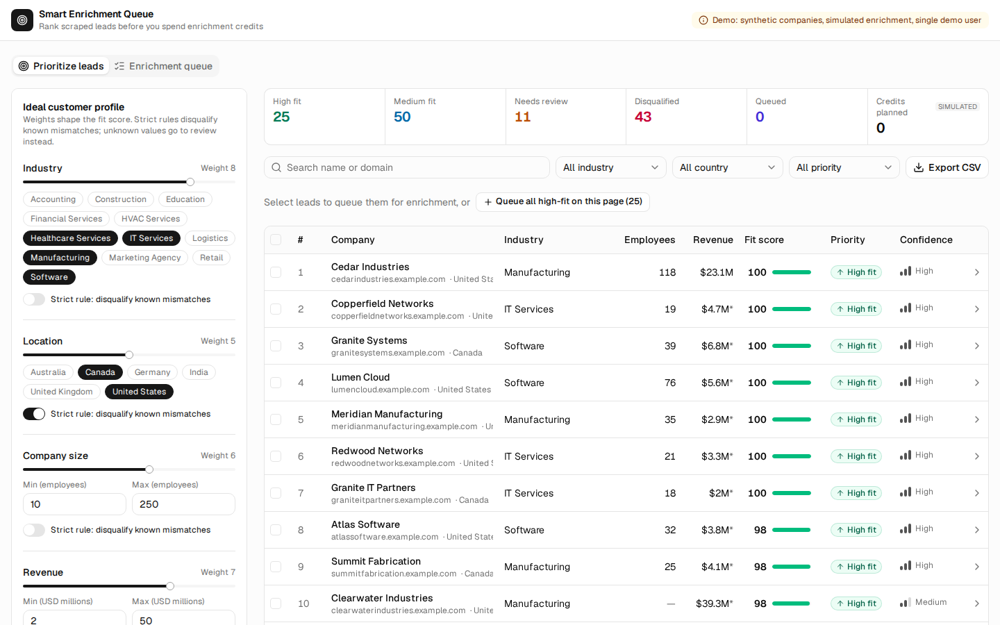
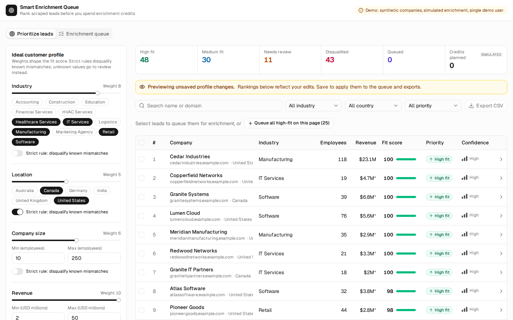
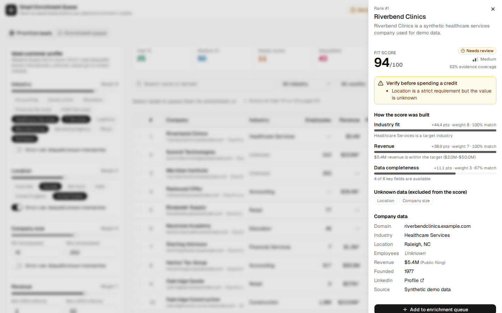
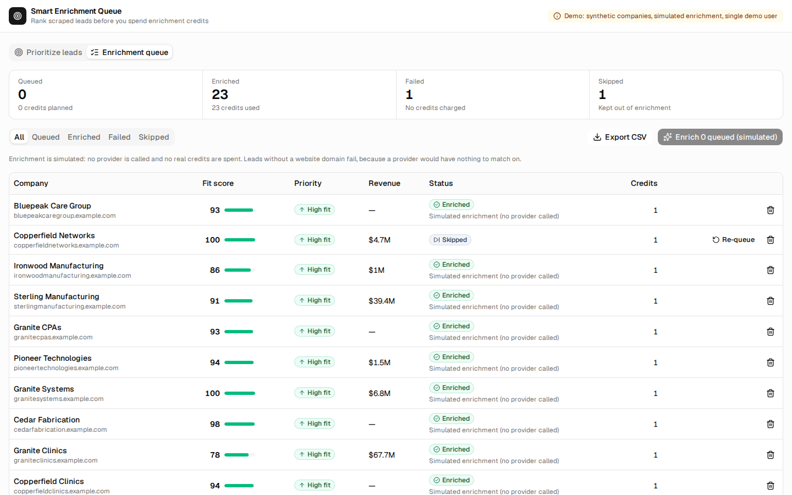
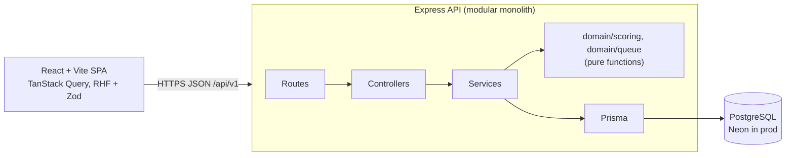

# Smart Enrichment Queue

**Stop guessing which leads deserve your credits.**

Finding hundreds of potential leads is easy. Knowing which ones are worth your time and enrichment
credits is the hard part. A feature built for [SaaSquatch Leads](https://www.saasquatchleads.com/),
Caprae Capital's lead generation and enrichment tool. SaaSquatch charges one credit per enriched
lead and promises users they can "only enrich the leads you want, so you never waste a single
credit". After a scrape, teams sort incomplete data, compare prospects by hand, and guess at ICP
fit. Credits go to poor-fit companies while stronger names go unnoticed. This tool turns that list
into a prioritized, explainable action plan.



## Why this feature

| User pain                                        | What the tool does                                                     |
| ------------------------------------------------ | ---------------------------------------------------------------------- |
| "Which of these 150 leads do I work first?"      | Ranks every lead by a 0–100 fit score against a configurable ICP       |
| Qualification is subjective and inconsistent     | Weighted factors and strict rules shared by everyone using the profile |
| Scores feel like a black box                     | Every score shows its factor contributions and reasons                 |
| Scraped records are incomplete                   | Missing data is shown as unknown, never counted as a mismatch          |
| Credits get spent on leads that were never a fit | A queue with planned and used credits, so poor fits never get queued   |
| Results need to go into a CRM or spreadsheet     | CSV export of ranked leads and of the queue                            |

The score is a **fit heuristic over the available evidence, not a probability of conversion**.

## What it does

1. **Configure an ICP.** Set weights (0–10) for industry, location, company size, revenue, and
   data completeness, plus the targets for each. Any factor can be made a _strict rule_.
2. **Preview before saving.** Every edit re-ranks the full list live, with a clear "previewing
   unsaved changes" state. Save or discard.
3. **Inspect a lead.** The detail panel shows the score, the points each factor contributed, the
   data that is unknown, any strict-rule violations, and where the revenue figure came from
   (AI estimate or public filing).
4. **Queue for enrichment.** Select leads, or queue every high-fit lead on the page in one click.
   Duplicates are reported explicitly, never silently skipped.
5. **Run enrichment (simulated).** Queued leads become enriched, or fail if there is no website
   domain to match on. Credits are only counted for successful enrichments. Items can be skipped
   and re-queued.
6. **Export.** Download ranked leads (filtered) or the queue as CSV.

| ICP preview                                      | Score explanation                                |
| ------------------------------------------------ | ------------------------------------------------ |
|  |  |



## Scoring model

Implemented as pure, deterministic functions in
[`apps/api/src/domain/scoring/score.ts`](apps/api/src/domain/scoring/score.ts) and unit tested.

```text
match_i  in [0, 1] per factor
  list factors (industry, country): 1 if the value is a target, else 0 (case-insensitive)
  range factors (employees, revenue): 1 inside [min, max]; value/min below; max/value above
  completeness: share of {domain, industry, country, employees, revenue, LinkedIn} present

score    = 100 * Σ(w_i · match_i over KNOWN factors) / Σ(w_i over KNOWN factors)
coverage = Σ(w_i over known factors) / Σ(w_i over configured factors)
```

- **Unknown is not zero.** A missing field is left out of the score and listed under missing
  factors. Coverage, and with it confidence, drops instead.
- **Hard and soft criteria are separate.** A known strict-rule violation means `disqualified`,
  with the reason. A strict field that is unknown means `needs_review`; it is never disqualified.
- **No evidence, no score.** If no fit factor is known, the score is `null` and the lead needs
  review. Completeness alone cannot produce a score.
- **Thresholds** (all inclusive): priority is high at 75 or above, medium at 50 or above, low
  below that. Confidence is high at 80% coverage or above, medium at 50% or above.
- **Stable ranking.** Order is qualified, then needs review, then disqualified. Within each group:
  score, then confidence, then name, then id. The whole filtered set is ranked before paginating,
  so rank numbers are global.
- Explanations come from the same factor objects that produce the score, so they can't disagree.

## Architecture



| Layer              | Technology                                                          |
| ------------------ | ------------------------------------------------------------------- |
| Language           | TypeScript (strict) end to end                                      |
| Frontend           | React 19, Vite 8, Tailwind CSS 4, shadcn/ui (Radix), lucide icons   |
| Client state/forms | TanStack Query 5, React Hook Form 7, Zod 4                          |
| API                | Node.js 22, Express 5, Zod 4, express-rate-limit                    |
| Database / ORM     | PostgreSQL 16 (Neon in production), Prisma 6                        |
| Testing            | Vitest, Supertest, React Testing Library, Playwright                |
| Hosting            | Vercel (static frontend + CDN), Render (API web service), Neon (DB) |
| CI                 | GitHub Actions                                                      |

The hosting is a managed multi-provider setup, not a single cloud. It gives a static frontend on
a CDN, an always-on Node service, and serverless Postgres with branching, all with Git-based
deploys.

### Backend layout (`apps/api/src`)

The API is a modular monolith: routes → controllers → services/domain → Prisma.
Lint keeps Prisma out of controllers, views, and routes.

| Layer          | Path                    | Responsibility                                                                  |
| -------------- | ----------------------- | ------------------------------------------------------------------------------- |
| Routes         | `routes/`               | Method, path, and middleware only                                               |
| Controllers    | `controllers/`          | Validate HTTP input, call a service, write the response                         |
| Views          | `views/`                | Response formatting that needs transformation (CSV)                             |
| Services       | `services/`             | Use cases and Prisma access (`companyService`, `queueService`, …)               |
| Domain         | `domain/scoring`        | Criteria schema, factor evaluation, thresholds, ranking                         |
| Domain         | `domain/queue`          | Queue status transitions (one source of truth) and simulated enrichment outcome |
| Schemas        | `schemas/`              | Zod request schemas: bounds, enums, whitelisted sort keys, bulk limits          |
| Middleware     | `middleware/`           | Request id, security headers, demo user, rate limits, central error handler     |
| Infrastructure | `lib/`, `config/env.ts` | Prisma client, structured logger, validated environment                         |

### Frontend layout (`apps/web/src`)

The frontend follows Model-View-Presenter, and lint enforces the boundary: views (`.tsx`) may not
import services or TanStack Query directly.

| Layer     | Path                        | Responsibility                                                       |
| --------- | --------------------------- | -------------------------------------------------------------------- |
| Model     | `services/http.ts`          | Transport: aborts with the query, maps the error envelope, CSV files |
| Model     | `services/*.service.ts`     | Business calls per domain (`leadsService`, `queueService`)           |
| Model     | `services/query-keys.ts`    | Cache keys shared by every presenter                                 |
| Model     | `lib/api-schemas.ts`        | Zod schemas for every API response; types are inferred from them     |
| Presenter | `features/*/use-*.ts`       | Queries, mutations, cache invalidation, and success messages         |
| View      | `features/leads/`, `queue/` | ICP form, ranked table, filters, detail sheet, queue view            |
| View      | `components/`, `ui/`        | Shared UI and shadcn/ui primitives                                   |

Every response is validated at runtime, so a contract mismatch shows a clear error instead of
rendering bad data. Error handling is centralised in `lib/query-client.ts`: every failed mutation
shows an error toast (never a success message), titled via `meta.errorTitle`; failed loads retry
transient errors, then show a Retry button. Exports are fetched (not plain links), so a failure is reported in the
UI. Motion is disabled when the OS asks for reduced motion.

### Data model

| Table              | Key points                                                                                                                                                                                                                                                                                               |
| ------------------ | -------------------------------------------------------------------------------------------------------------------------------------------------------------------------------------------------------------------------------------------------------------------------------------------------------- |
| `users`            | One seeded demo user (no authentication; see limitations).                                                                                                                                                                                                                                               |
| `companies`        | Typed, indexed filter and sort columns (`industry`, `country`, `employee_count`, `estimated_revenue`, `name`). NULL means unknown. `revenue_source` records provenance. `attributes` JSONB holds non-queried fields. Unique on (`source`, `source_record_id`). Check constraints block negative metrics. |
| `user_preferences` | One row per user (PK = `user_id`). `criteria` JSONB, validated by the shared Zod schema on every read and write.                                                                                                                                                                                         |
| `queue_items`      | **Unique (`user_id`, `company_id`)**, so duplicates are impossible even under concurrency. Status enum `queued / enriched / failed / skipped`, `estimated_credits >= 0`, index on (`user_id`, `status`, `added_at`).                                                                                     |

Scores are **not stored**. They are recomputed from current data and the current profile, so
they can never go stale. If score history were needed, the next step would be a `scoring_runs`
table holding a snapshot of the profile.

### API (`/api/v1`)

| Method & path                      | Purpose                                                                                                      |
| ---------------------------------- | ------------------------------------------------------------------------------------------------------------ |
| `GET /health`, `/health/ready`     | Liveness check, and readiness including the database                                                         |
| `GET /meta`                        | Filter options, thresholds, credits per enrichment, demo flags                                               |
| `GET /companies`, `/companies/:id` | Search and sort (whitelisted keys); detail with score and queue status                                       |
| `GET / PUT /preferences`           | Read or save the ICP criteria                                                                                |
| `POST /scoring/preview`            | Rank with an unsaved profile (nothing is persisted)                                                          |
| `GET /leads/ranked`                | Ranked page with summary counts; filters `q`, `industry`, `country`, `priority`                              |
| `GET /leads/export`                | Ranked leads as CSV                                                                                          |
| `GET /queue`                       | Paginated queue items (optional `status` filter) and a summary over all items (counts, planned/used credits) |
| `POST /queue/items`                | Bulk add (up to 100). Returns a per-item outcome: `added`, `duplicate` or `not_found`. 201 if any were added |
| `PATCH /queue/items/:id`           | `{status}` only. Allowed: queued→skipped, skipped→queued, failed→queued. Otherwise 409                       |
| `DELETE /queue/items/:id`          | 204. Returns 404 if the item is missing or belongs to someone else (not idempotent)                          |
| `POST /queue/enrich`               | Simulated enrichment of queued items. Counts and credits come from the rows actually updated                 |
| `GET /queue/export`                | Queue as CSV (optional `status`; capped at 5,000 rows, 422 beyond that)                                      |

Errors always use the shape `{ "error": { "code", "message", "requestId", "details?" } }`. Status
codes: 400 validation, 404 missing, 409 conflict or invalid transition, 413 body too large, 422
result set too large, 429 rate limited, 500 unexpected, 503 database unavailable (also what
`/health/ready` returns when Postgres is down). Stack traces and SQL are never returned; they are
logged server-side with the request id.

### Performance and caching

- **Browser:** TanStack Query caches per query key with a 30s stale time. Every mutation
  invalidates the affected queries. Preview requests are debounced (350 ms), and the previous
  results stay on screen while the next ones load.
- **API:** scoring is cheap, in-process work over the filtered set. That set is capped at 5,000
  rows (beyond that the API returns 422 and you narrow the filters). Only the columns the API
  exposes are selected. Queue statuses are fetched in one batched query per page, not one per row.
- **Database:** indexes match the filter, sort and queue-view patterns. Pagination is bounded
  (max 100 per page).
- **No Redis:** nothing measured needs a shared cache. The trigger to add one would be scoring
  latency over a much larger catalogue, or rate limiting across multiple API instances.
- **Static assets:** Vercel serves hashed assets with immutable caching.

### Security and data handling

- Every request value is validated with Zod at the boundary. Unknown fields are rejected, so
  there is no mass assignment, and sort and filter keys are whitelisted.
- CORS is limited to `FRONTEND_ORIGIN`. Rate limits are 300/min globally and 20/min for exports.
  JSON bodies are capped at 32 KB.
- CSV export escapes delimiters, quotes and newlines, and neutralises spreadsheet formula
  injection (cells starting with `= + - @`).
- Every queue query is scoped to the current user. Tests prove another user's items can't be
  read, changed, deleted or enriched.
- Logs are structured JSON with request ids. No secrets or contact data are logged.
- **Ethical data:** the dataset is synthetic (no real companies, no personal contact data).
  Enrichment is simulated and labelled as such everywhere.

## Getting started

Prerequisites: Node.js 20 or later and Docker.

```bash
npm install
npm run db:up                         # Postgres 16 on localhost:5433 (dev + test databases)
cp .env.example apps/api/.env         # API settings; the defaults work with docker compose
echo "VITE_API_BASE_URL=http://localhost:4000/api/v1" > apps/web/.env
npm run db:migrate                    # apply migrations to seq_dev
npm run db:seed                       # demo user + 150 synthetic companies (idempotent)
npm run dev                           # API on :4000, web on :5173
```

Open http://localhost:5173 for the guide. The workspace is http://localhost:5173/?view=leads.

### API / notebook demo

[`docs/demo/api-walkthrough.ipynb`](docs/demo/api-walkthrough.ipynb) is the Jupyter walkthrough of
the live API: health, ranked leads, unknown-vs-zero explanations, unsaved ICP preview, queue
duplicates, and simulated enrichment with credits. Start the stack above, then Run All. It uses
only the Python standard library. Optional: `SEQ_API_BASE` if the API is not
`http://localhost:4000/api/v1`.

### Quality checks

```bash
npm run lint && npm run typecheck && npm run format:check
npm test             # API unit + Supertest integration (against seq_test) and web component tests
npm run test:e2e     # Playwright; starts its own API (:4100) and web (:5180) against a reseeded seq_test
npm run build
```

What the tests cover:

- **Unit:** scoring (unknown vs mismatch, strict rules, null score, partial range credit,
  threshold boundaries, deterministic ties), queue transitions, CSV escaping.
- **API integration:** validation errors, persisting preferences, preview not saving, global rank
  across pages, queue pagination, duplicate and unknown ids in bulk adds, concurrent duplicate adds (exactly one
  insert), status transitions, simulated enrichment and credits, ownership isolation, unique,
  foreign key and check constraints, a repeatable seed, and CSV output.
- **Component:** the score explanation, ICP form behaviour (keyboard slider, chips, discard,
  USD scaling, inverted-range validation), lead table loading/empty/selectable states, and the
  queue view's empty state, load error with retry, and failed enrichment (no false success).
- **API client:** response validation, error envelope mapping, network errors, abort signal
  forwarding, and CSV download filenames.
- **E2E:** configure the ICP, preview, discard, relax a strict rule and save, check it persists
  after reload, inspect a lead, queue it, skip and re-queue it, enrich it, and export CSV.

## Deployment

1. **Neon:** create a project and copy the **pooled** connection string (`DATABASE_URL`) and the
   **direct** one (`DIRECT_URL`, used for migrations). Use separate Neon branches for dev and prod.
2. **Render (API):** create a Blueprint from [`render.yaml`](render.yaml), then set
   `DATABASE_URL`, `DIRECT_URL` and `FRONTEND_ORIGIN` (the Vercel URL). The build runs
   `prisma migrate deploy` and the idempotent demo seed once per deploy (on the free plan, which
   has no pre-deploy step), and `/api/v1/health/ready` gates traffic.
3. **Vercel (web):** import the repo with root directory `apps/web` (settings in
   [`apps/web/vercel.json`](apps/web/vercel.json)) and set `VITE_API_BASE_URL` to the Render URL
   plus `/api/v1`.
4. **CI:** [`.github/workflows/ci.yml`](.github/workflows/ci.yml) runs format, lint, typecheck,
   unit and integration tests, build and Playwright against a Postgres service on every PR and
   push to `main`. Render and Vercel deploy `main` through their Git integrations.

Rollback means redeploying the previous build in Render or Vercel. Keep migrations backward
compatible (expand, then contract), because the old API keeps serving while the new one starts.

## Known limitations

- **No authentication.** Every request acts as one seeded demo user. Data isolation is enforced
  in queries and tested, but this is not production identity or tenant security.
- **Synthetic data and simulated enrichment.** There is no live scraper or enrichment provider.
  Credit figures are a demo estimate of 1 credit per enrichment (`CREDITS_PER_ENRICHMENT`), which
  matches SaaSquatch's "one credit unlocks the full lead profile". They are not real pricing or
  savings.
- **List factors are all-or-nothing.** Industry and country either match or they don't, so many
  strong leads tie at 100. Ties are broken by confidence and then name. Similarity between
  industries would be the next improvement.
- In-process ranking is capped at 5,000 companies per filtered set.
- The frontend ships as a single ~190 KB (gzipped) bundle. It is not code-split.

## Scope note

This implements the full Smart Enrichment Queue proposal (sized at 12–16 hours). That is larger
than the handbook's 5-hour guideline. The core is ICP scoring, explanations and the queue; tests,
CI and deployment configuration are the surrounding layers.

## Video walkthrough outline (1–2 min)

1. **Problem (15s):** a SaaSquatch scrape leaves hundreds of leads, and every enrichment costs a
   credit. Which ones deserve it?
2. **Demo (60s):** adjust the ICP and watch the live preview. Open a lead that scores 94 but needs
   review because its location is unknown. Queue the high-fit leads, skip one, run enrichment, and
   see the domain-less lead fail without using a credit. Export CSV.
3. **Design choices (30s):** deterministic, explainable scoring instead of an LLM. Unknown is not
   zero. Strict and weighted criteria are separate. A database-enforced, duplicate-safe queue. The
   stack and hosting.
4. **Next (15s):** real enrichment provider adapter, authentication, industry similarity, and
   feedback on which leads actually convert.
